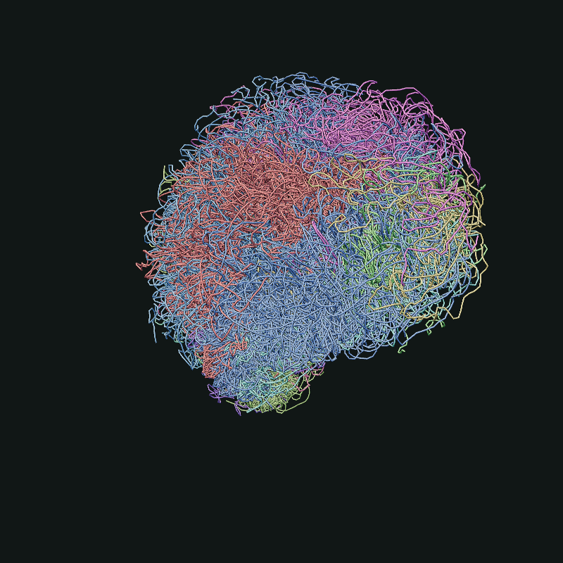
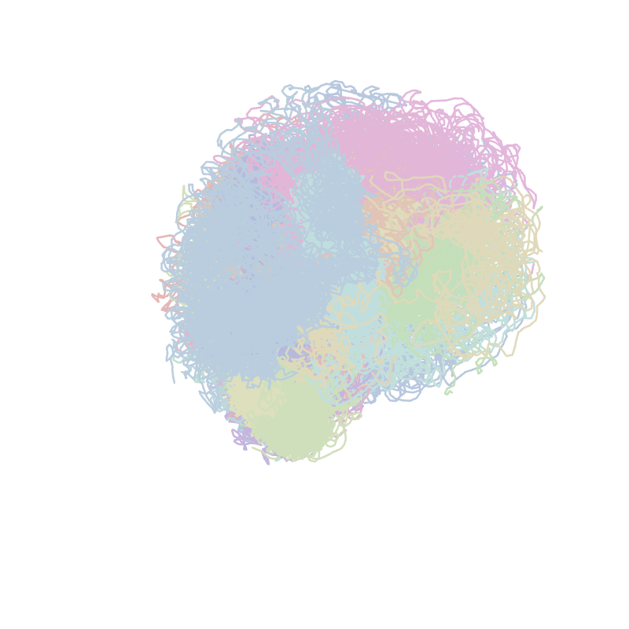
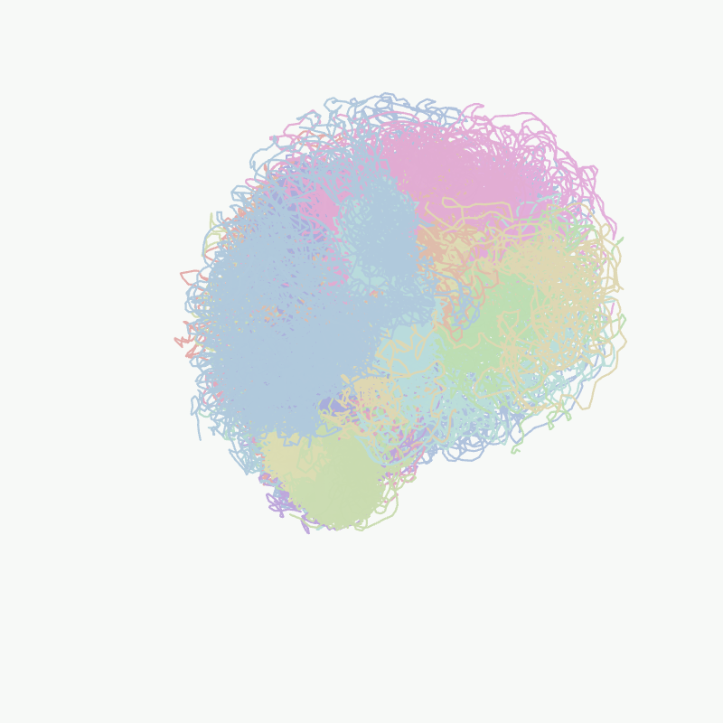
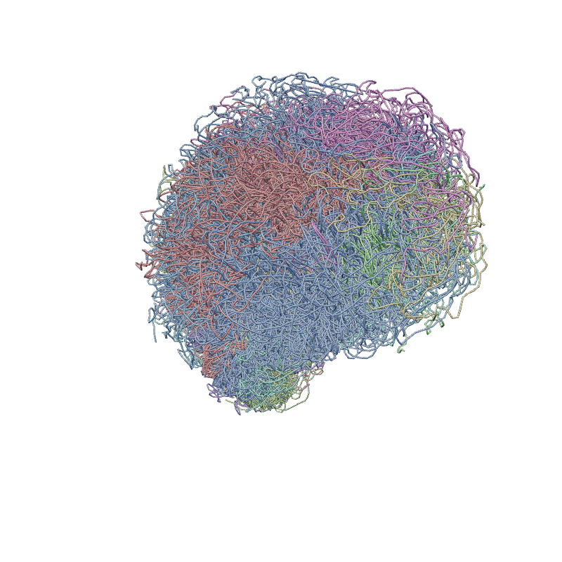
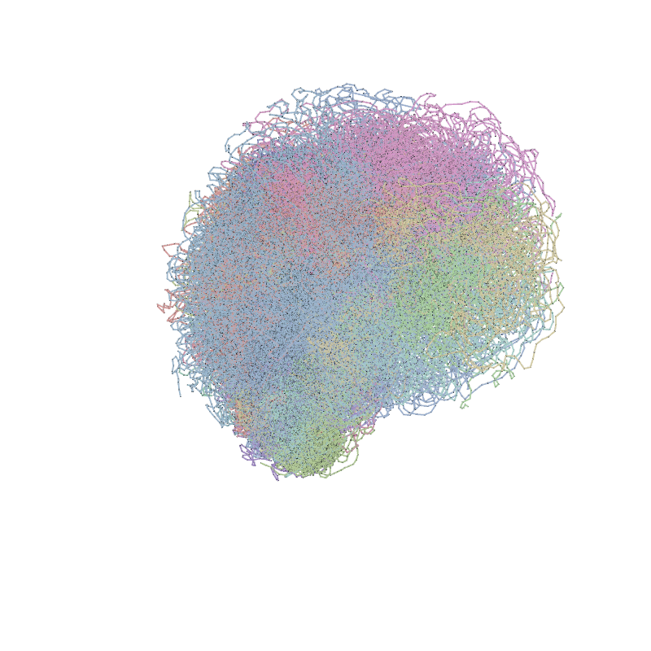
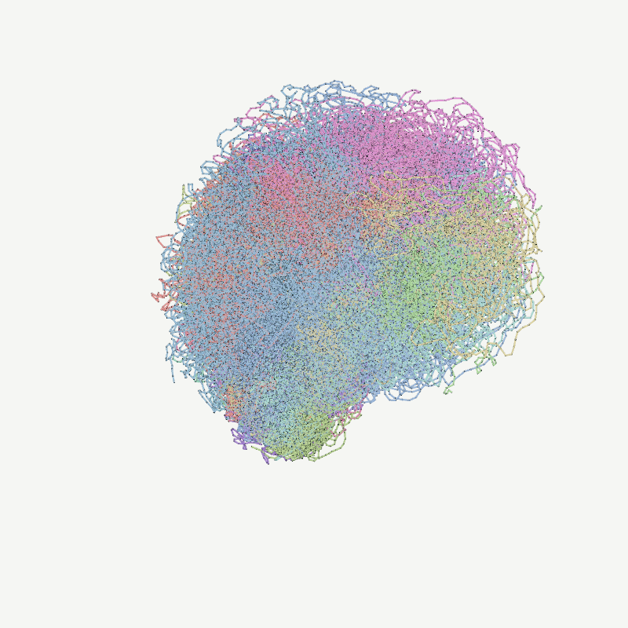

# 3D Genome Viewer and Direct Renderer

`hic_basic.visualize` provides an in-process alternative to the existing PyMOL
and ChimeraX workflows for reviewing `.3dg` structures. It writes one portable
HTML file containing the scene data, CSS, and a pinned Three.js 0.185.1 bundle.
Generating the file does not start a server, invoke a GUI, translate through
mmCIF, use Node.js, or require a GPU.

The same package also provides a direct PNG entry point. It accepts native
structures or a previously generated HTML, applies a versioned render request,
and returns a machine-readable provenance report without interactive steps.

## Quick Start

From the command line:

```bash
./run_in_env.sh hic_basic view3d sample.20k.3dg -o sample.20k.html
```

From Python:

```python
from hic_basic.visualize import write_structure_html

write_structure_html(
    "sample.20k.3dg",
    "sample.20k.html",
    regions=["chr1(mat):0-50Mb", "chr2(pat):10Mb-30Mb"],
    bond_size=1.5,
    background="#151918",
    export_profile="molecular-studio-v1",
)
```

For separate scene construction and output configuration:

```python
from hic_basic.visualize import structure_scene, view_structure

scene = structure_scene(
    structure_df,
    color="score",
    cmap="viridis",
    vmin=0,
    vmax=1,
    max_bond_gap=1_000_000,
)
viewer = view_structure(scene, title="Cell 12", regions=["chr1", "chr8"])
viewer.write_html("cell12.structure.html")
```

`structure_df` may have a `(chr, pos)` MultiIndex and `x, y, z` columns, which
is the native shape returned by common 3dg parsers. A flat DataFrame with
`chrom` or `chr`, `pos`, `x`, `y`, and `z` is also accepted.

## Direct PNG Rendering

The primary programmatic entry point is `render_structure_png`:

```python
from hic_basic.visualize import (
    CameraConfig,
    ExportStyle,
    LayerConfig,
    RasterConfig,
    SectionConfig,
    StructureRenderConfig,
    ViewConfig,
    render_structure_png,
    structure_scene_with_feature,
)

scene = structure_scene_with_feature(
    "sample.20k.3dg",
    "hg19.cpg.20k.txt",
    feature_name="CpG density",
    cmap="pymol-cpg",
    vmin=0.005,
    vmax=0.020,
    max_bond_gap=20_000,
)
config = StructureRenderConfig(
    view=ViewConfig(
        regions=("chr1(mat):0-50Mb", "chr8(pat)"),
        camera=CameraConfig(mode="fit", direction=(0, 0, 1), fov=34),
        section=SectionConfig(enabled=True, thickness=2, offset=0),
    ),
    layers=LayerConfig(show_particles=False, show_bonds=True),
    style=ExportStyle(
        profile="section-studio-v1",
        show_colorbar=True,
    ),
    raster=RasterConfig(width=2000, height=2000),
)
result = render_structure_png(scene, "cell12.cpg-section.png", config=config)
print(result.to_dict())
```

Accepted sources are a `.3dg` path, native DataFrame, `StructureScene`,
`StructureViewer`, or a compatible standalone HTML. Use a `StructureScene`
when custom colors or data annotations matter; a bare `.3dg` path uses default
chromosome colors. The HTML path is useful for rendering an archived review
artifact without reconstructing its Python input.

The CLI uses the same API:

```bash
./run_in_env.sh hic_basic render3d sample.20k.3dg \
  -o sample.20k.png --config render.json

./run_in_env.sh hic_basic render3d sample.20k.html \
  -o sample.from-html.png --config render.json

./run_in_env.sh hic_basic render3d sample.20k.3dg \
  --feature hg19.cpg.20k.txt --feature-name "CpG density" \
  --cmap pymol-cpg --vmin 0.005 --vmax 0.020 \
  --max-bond-gap 20000 -o sample.cpg-section.png --config section.json
```

`render.json` is a strict, versioned document. Unknown fields and invalid
camera or width values fail before the browser starts:

```json
{
  "schema_version": 1,
  "view": {
    "regions": ["chr1(mat):0-50Mb", "chr8(pat)"],
    "camera": {
      "mode": "explicit",
      "position": [92.0, 61.0, 118.0],
      "target": [0.0, 0.0, 0.0],
      "up": [0.0, 1.0, 0.0],
      "fov": 34.0,
      "direction": null
    },
    "section": {
      "enabled": true,
      "thickness": 2.0,
      "offset": 0.0
    }
  },
  "layers": {
    "show_particles": false,
    "show_bonds": true,
    "show_annotations": true
  },
  "style": {
    "profile": "section-studio-v1",
    "tube_width": null,
    "silhouette_width": null,
    "particle_size": null,
    "background": "#f7f9f7",
    "show_colorbar": true
  },
  "raster": {
    "long_edge": 2400,
    "width": 2400,
    "height": 1600
  }
}
```

Use `camera.mode="fit"` with `position` and `target` set to `null` for a
deterministic fitted view. `direction` is the direction from the camera target
toward the camera; `[0, 0, 1]` matches the default PyMOL section orientation.
For an explicit camera, set `direction` to `null`. Explicit `width` and
`height` give the strongest reproducibility. If they are `null`, `long_edge`
is combined with the headless viewport aspect ratio.

`section.thickness` and `section.offset` use the spatial coordinate units of
the 3dg file. The slab is perpendicular to the viewing direction and centered
on the camera target; positive offset moves it toward the camera. Both clipping
planes are applied to particles and polymer bonds.

## Opening the HTML

The output is a standalone file. On a local machine, open it directly in a
normal browser. No Python process needs to remain running.

For Remote SSH, either download the HTML with the VS Code file explorer and
open it locally, or serve its directory on the remote host:

```bash
./run_in_env.sh python -m http.server 8765 --bind 127.0.0.1 --directory results
```

Forward port `8765` in VS Code and open `http://127.0.0.1:8765/sample.20k.html`
in a local browser. VS Code `Show in Preview` is not the recommended path for
large standalone viewers: its webview security and memory policies can leave
an inline WebGL document at `Loading` even when the same file works in a normal
browser.

## Polymer Bond Contract

A bond represents polymer-chain continuity between genome-bin particles. The
adapter performs a stable sort within each chromosome or haplotype and connects
only adjacent genomic positions whose gap is at most `max_bond_gap`.

- Bonds never cross chromosome or haplotype boundaries.
- Bonds are not inferred from 3D distance.
- Spatial contacts, restraints, and annotation edges are not polymer bonds.
- Setting `polymer_bonds=False` or CLI `--no-bonds` produces a particle-only
  scene.

The default `max_bond_gap` is 1,000,000 bp for compatibility with the existing
hires_utils/mmCIF conversion behavior.

## Color Inputs

`structure_scene(..., color=...)` accepts:

- `"chrom"`: deterministic chromosome territory colors;
- one Matplotlib color specification such as `"#708087"`: one constant color
  for the complete base polymer;
- a numeric DataFrame column: continuous `cmap`, `vmin`, and `vmax` mapping;
- a categorical DataFrame column: deterministic categories or an explicit
  `palette` mapping;
- a length-N sequence of Matplotlib color specifications;
- an N x 3 RGB array in either 0..1 or 0..255 range.

Colors remain aligned with particles after genomic sorting and are used by both
the monitor and high-quality PNG profiles. For custom chromosome colors:

```python
scene = structure_scene(
    structure_df,
    color="chrom",
    palette={"chr1(mat)": "#007f8b", "chr1(pat)": "#d1495b"},
)
```

For a haploid genome-bin track such as the legacy CpG reference, use
`structure_scene_with_feature`. It normalizes optional `chr` prefixes and maps
each reference row to both homologs by default:

```python
from hic_basic.visualize import structure_scene_with_feature

scene = structure_scene_with_feature(
    "sample.20k.3dg",
    "hg19.cpg.20k.txt",  # headerless: chrom, pos, value
    feature_name="CpG density",
    cmap="pymol-cpg",
    vmin=0.005,
    vmax=0.020,
    max_bond_gap=20_000,
)
```

Every particle receives its feature color; every bond interpolates the colors
of its endpoint particles. The scene stores the color mapping and match count
for provenance and colorbar generation. Set `duplicate_haplotypes=False` when
the track already contains separate `(mat)` and `(pat)` rows. Duplicate feature
keys are rejected.

## Structure Annotations

Annotations are first-class scene content, separate from base-polymer colors
and export profiles. Python resolves each genomic target once against the
scene's stable particle and bond order. The standalone HTML and direct PNG
renderer consume the same resolved indices, so they cannot disagree about
interval endpoints or polymer gaps.

```python
from hic_basic.visualize import (
    annotate_structure,
    genomic_segment_annotation,
    render_structure_png,
    structure_scene,
    view_structure,
)

scene = structure_scene(
    "sample.10k.3dg",
    color="#708087",
    max_bond_gap=10_000,
)
scene = annotate_structure(
    scene,
    [
        genomic_segment_annotation(
            "chr1(pat):20000-30000",
            id="anchor-1",
            label="Anchor 1",
            color="#ff0000",
            material="unlit",
            tube_width=10,
            outline_width=13,
            outline_color="#7f0000",
        ),
        genomic_segment_annotation(
            "chr1(pat):60000-70000",
            id="anchor-2",
            label="Anchor 2",
            color="#00d000",
            material="unlit",
            tube_width=10,
            outline_width=13,
            outline_color="#006800",
        ),
    ],
    layer="loop-anchors",
    layer_label="Loop anchors",
)

view_structure(scene).write_html("sample.annotated.html")
result = render_structure_png(scene, "sample.annotated.png")
```

Genome-region selectors are inclusive: a 10-kb selector on a 10-kb structure
includes both edge particles and the real bond between them. Resolution only
selects bonds already present in `scene.bonds`; it never bridges a chromosome,
haplotype, missing bin, or `max_bond_gap` boundary. Adjacent annotations may
share an endpoint particle, but annotations sharing a polymer bond are rejected
to avoid accidental insertion-order precedence.

The initial typed mark is `TubeMark`. `material="unlit"` bypasses profile
saturation, lightness, depth cue, PBR lighting, and tone mapping, preserving an
opaque semantic sRGB color apart from antialiased boundary pixels.
`material="profile"` opts into the active profile. `occlusion="depth_tested"`
is the scientific default; `"always_visible"` is an explicit overlay policy.
Tube and outline widths are diameters in reference pixels at a 1400-pixel PNG
width and do not alter the base polymer. An optional outline remains an unlit
semantic halo even when the primary tube uses `material="profile"`.

`StructureScene.annotation_layers` provides the common extension point for
future text, arrow, point, and emphasis marks. An annotation owns one resolved
target and one or more typed marks, so future marks can reuse the same genome
membership. Unknown mark kinds are rejected rather than silently ignored.
`LayerConfig.show_annotations` is a global render visibility override; layer
identity, annotation styles, and resolved target membership remain scene data.

`RenderResult.to_dict()` reports each layer and annotation, including its stable
id, original selector, resolved and rendered counts, requested and resolved
colors, widths, material, opacity, occlusion, and whether profile transforms and
tone mapping were bypassed.

## Viewer and Export

The monitor provides orbit, pan, zoom, particle picking, particle, bond, and
annotation visibility, particle and bond size, background color,
fit-to-selection, and a union of multiple chromosome or genomic-region
selections. It also provides a section toggle plus thickness and offset
sliders; the slab remains aligned to the current camera while orbiting. An
unphased region such as `chr1:0-20Mb` expands to both homologs when the scene
contains `chr1(mat)` and `chr1(pat)`.

The PNG button and `render_structure_png` call the same versioned browser
protocol and high-quality renderer. The button captures the current camera,
regions, and layer switches; direct rendering obtains them from the config.
Available stable profiles are:

| Profile | Intended use |
| --- | --- |
| `molecular-studio-v1` | Default dark, opaque PBR tube rendering |
| `section-pymol-v1` | Flat PyMOL CpG-section baseline with Min/Max colorbar |
| `section-studio-v1` | Preferred clean bond rendering with depth cue and numeric colorbar |
| `xu2025-v2` | Preferred light publication rendering |
| `xu2025-v1` | Versioned Xu 2025 baseline compatibility |
| `publication-v1` | Versioned legacy light rendering |

The examples below use the same real mouse whole-genome structure
(`BJ9205.clean.20k.4.3dg`; 113,801 particles across chromosomes 1-19 and X,
with a 20 kb modal interval), chromosome-territory colors, camera, and
800 x 800 raster. Particles are hidden so the profile-specific polymer
rendering remains legible. The PNGs are stored as losslessly compressed RGB
files.

| | |
| --- | --- |
| **`molecular-studio-v1`**<br> | **`section-pymol-v1`**<br> |
| **`section-studio-v1`**<br> | **`xu2025-v2`**<br> |
| **`xu2025-v1`**<br> | **`publication-v1`**<br> |

Regenerate the examples from an equivalent 20 kb whole-genome structure with:

```bash
./run_in_env.sh --cpu 4 --mem 16G --time 30m \
  python scripts/generate_structure_profile_examples.py sample.20k.3dg
```

Parameters under an existing profile name are treated as a visual compatibility
contract. New aesthetics require a new versioned profile name. `tube_width`,
`silhouette_width`, `particle_size`, `background`, and `show_colorbar` are
explicit overrides; the returned report records their resolved values. Mesh
profiles default to opaque polymer tubes without embedded particle spheres.
Legacy line profiles default to both bonds and particles for old-result
compatibility.

## Rendering Environment

Playwright 1.58.1 and its CPU WebGL runtime libraries are registered in
`envs/dependencies.yml`, rendered into `environment.yml`, and pinned in the
Conda lock. Create and verify environments through the repository workflow:

```bash
make env-create
make env-check
```

Playwright's matching headless Chromium is a separately cached executable. It
is never downloaded by `render_structure_png`. Install it once after creating
or bootstrapping an environment:

```bash
make renderer-bootstrap
```

The default backend forces SwiftShader, so a GPU and display server are not
required. `BrowserBackendConfig` can select an explicit compatible browser,
timeout, viewport, or hardware rendering. Backend choices are deliberately not
part of `StructureRenderConfig`: they describe execution, not the scientific
view. Browser requests to HTTP and HTTPS are blocked during direct rendering;
the standalone HTML and scene data remain offline.

## Architecture and Runtime

```text
.3dg path / native DataFrame
            |
            v
structure_scene -> StructureScene
  particles + genomic identity + polymer bonds + annotation layers
            |                         |
            v                         v
view_structure                 render_structure_png
            |                         ^
            v                         |
standalone HTML ----------------------+
  monitor + versioned render protocol
            |
            v
Playwright + headless Chromium -> validated PNG + RenderResult
```

`StructureScene` contains validated NumPy arrays, typed renderer-independent
annotations, and JSON-compatible metadata. It does not expose Three.js objects.
Arrays are serialized with explicit dtype, shape, byte order, and checksum
descriptors. Writes are atomic.

The 20 kb concept dataset used for acceptance contains 285,395 particles and
285,309 bonds. It was checked in Chromium with SwiftShader software WebGL, so a
physical GPU is not required. The monitor keeps the whole genome to two draw
calls at default bond width. High-quality whole-genome tube export is a separate
operation and is expected to be slower under software rendering.

## Compatibility Boundary

Existing PyMOL/ChimeraX APIs and the legacy `hic_basic render` command remain
unchanged. `hic_basic render3d` is the direct browser renderer. Renderer
protocol version 2 accepts HTML produced by this implementation. Protocol 1
HTML predates cross-section semantics and is rejected instead of silently
ignoring `view.section`; older concept demo HTML files without a protocol also
fail with an actionable mismatch. A server-side path tracer and custom
non-polymer contact-edge topology are not part of this API version.
