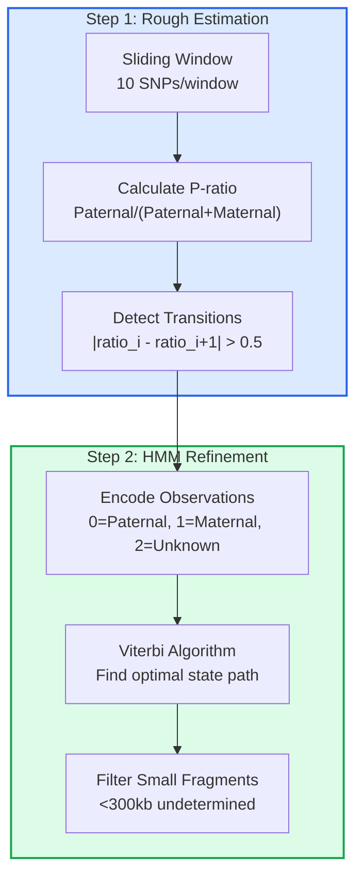

# Crossover Detection Module

## Overview

The `hic_basic.crossover` module implements the Lu et al. (2012) Science method for detecting meiotic crossover events from single sperm whole-genome sequencing data.

**Reference:**
> Lu S, Zong C, Fan W, et al. Probing Meiotic Recombination and Aneuploidy of Single Sperm Cells by Whole-Genome Sequencing. *Science*. 2012;338(6114):1627-1630. DOI: [10.1126/science.1229112](https://www.science.org/doi/10.1126/science.1229112)

## Key Features

- **Two-step crossover detection**: Rough estimation + HMM refinement
- **Fault-tolerant pipeline**: Intermediate caching with flag files
- **Parallel processing**: Multi-sample processing with shared memory
- **Integration**: Reuses `hic_basic.sam` and `hic_basic.phasing` infrastructure
- **Resume capability**: Can resume from interruption point

## Module Structure

```
hic_basic/crossover/
├── __init__.py          # Module exports
├── detector.py          # HMM core algorithm
├── cache.py             # Intermediate caching & flag management
├── io.py                # I/O operations & data loading
└── pipeline.py          # End-to-end pipeline & parallel processing
```

## Pipeline File Types


### File Format Details

| Step | File Type | Extension | Format | Key Columns |
|------|-----------|-----------|--------|-------------|
| **Input** | BAM/SAM | `.bam`/`.sam` | Binary/Text | Standard SAM format |
| **1. Marked Alleles** | Allele calls | `.parquet`/`.tsv.gz` | Parquet/TSV | `chrom, pos, allele, read_name` |
| **2. Allele Counts** | Per-SNP counts | `.parquet` | Parquet | `chrom, pos, ref, alt, other, gt` |
| **3. Genotypes** | Called genotypes | `.parquet` | Parquet | `chrom, pos, sperm_genotype, haplotype_1, haplotype_2` |
| **4. Haplotype Blocks** | Block calls | `.parquet`/`.tsv` | Parquet/TSV | `chromosome, start_pos, end_pos, haplotype, confidence` |
| **5. Crossovers** | Final calls | `.tsv` | TSV | `chromosome, position, from_haplotype, to_haplotype` |

## Algorithm

### Two-Step Method



### HMM Model

**States:**
- **P (0)**: Paternal haplotype
- **M (1)**: Maternal haplotype  
- **U (2)**: Undetermined

**Transition Matrix:**
```
        To:    P       M       U
From P      1-pc    pc      0.01
     M      pc      1-pc    0.01
     U      0.01    0.01    1-2*0.01

where pc = crossover_rate / 2
```

**Emission Matrix:**
```
        Obs:   Paternal  Maternal  Unknown
State P       1-ε       ε         0.01
      M       ε         1-ε       0.01
      U       0.01      0.01      0.98

where ε = error_rate (default 0.05)
```

## Usage

### Quick Start (End-to-End)

```python
from hic_basic.crossover import detect_crossovers_end2end

# Single sample analysis
results = detect_crossovers_end2end(
    sam_file="sperm01.bam",
    ref_snp_file="reference_snps.tsv",
    phasing_file="phasing_info.tsv",
    output_dir="output/",
    n_jobs=4,              # Parallel processes
    window_size=10,        # SNP window size
    min_fragment_size=300000,  # 300kb minimum
    error_rate=0.05,
)

# Access results
print(f"Total crossovers: {len(results.crossovers)}")
print(f"Total blocks: {len(results.haplotype_blocks)}")
print(f"Mean confidence: {results.statistics['mean_confidence']:.3f}")

# Save individual crossover positions
for xo in results.crossovers:
    print(f"{xo.chromosome}:{xo.position} {xo.from_haplotype}→{xo.to_haplotype}")
```

### Multi-Sample Parallel Processing

```python
from hic_basic.crossover import process_sample_parallel

# Define samples
sam_files = {
    "S01": "sperm01.bam",
    "S02": "sperm02.bam",
    "S03": "sperm03.bam",
}

# Process all samples in parallel
all_results = process_sample_parallel(
    sample_ids=list(sam_files.keys()),
    sam_files=sam_files,
    ref_snp_file="reference_snps.tsv",
    phasing_file="phasing_info.tsv",
    output_dir="output/",
    n_jobs=8,
    cache_dir="/tmp/crossover_cache",
)

# Check results
for sample_id, result in all_results.items():
    if result["success"]:
        print(f"✓ {sample_id}: {result['statistics']['total_crossovers']} crossovers")
    else:
        print(f"✗ {sample_id}: {result.get('error', 'Unknown error')}")
```

### Using Core Classes

```python
from hic_basic.crossover import CrossoverDetector

# Initialize detector
detector = CrossoverDetector(
    window_size=10,
    min_fragment_size=300000,
    error_rate=0.05
)

# Load data
detector.load_snp_data("sperm_snps.tsv")
detector.load_phasing_data("phasing.tsv")

# Run detection
results = detector.detect_crossovers("S01", chromosome="chr1")

# Save results
detector.save_results("output/", sperm_id="S01")
```

### Resuming Interrupted Pipeline

```python
from hic_basic.crossover.pipeline import resume_pipeline, get_pipeline_status

# Check pipeline status
status = get_pipeline_status(
    sam_file="sperm01.bam",
    ref_snp_file="snps.tsv",
    cache_dir="output/.cache",
    sample_id="S01"
)

print("Pipeline status:")
for step, completed in status.items():
    symbol = "✓" if completed else "○"
    print(f"  {symbol} {step}")

# Resume from last completed step
results = resume_pipeline(
    sam_file="sperm01.bam",
    ref_snp_file="snps.tsv",
    phasing_file="phasing.tsv",
    output_dir="output/",
    sample_id="S01",
    n_jobs=4
)
```

## Caching System

### Cache Manager

The `CacheManager` provides content-addressable storage with flag files:

```python
from hic_basic.crossover.cache import CacheManager

cache = CacheManager("/tmp/crossover_cache")

# Compute unique key from parameters
params = {"sample_id": "S01", "window_size": 10}
key = cache.compute_key(params)

# Save with automatic flagging
cache.save(dataframe, key, "marked_alleles")
cache.set_flag(key, "marked_alleles")

# Check if step is complete
if cache.is_flagged(key, "marked_alleles"):
    data = cache.load(key, "marked_alleles")

# Get or compute pattern
data = cache.get_or_compute(
    key, "step_name",
    compute_fn=lambda: expensive_computation()
)
```

### Shared Memory

For efficient parallel processing:

```python
from hic_basic.crossover.cache import SharedMemoryManager

smm = SharedMemoryManager("/tmp/shm")

# Share large array
arr = np.random.rand(1000000)
key = smm.share(arr, "snp_positions", sample_id="S01")

# Retrieve in worker process
retrieved = smm.get(key)
```

## Output Files

The pipeline generates the following output files per sample:

| File | Description | Columns |
|------|-------------|---------|
| `{sample}_haplotype_blocks.tsv` | Haplotype block calls | chromosome, start_pos, end_pos, haplotype, confidence, num_snps |
| `{sample}_crossovers.tsv` | Crossover positions | sperm_id, chromosome, position, start_pos, end_pos, from_haplotype, to_haplotype, confidence, resolution_kb |
| `{sample}_statistics.tsv` | Summary statistics | total_crossovers, total_blocks, chromosomes_analyzed, mean_resolution_kb, mean_confidence |

## Quality Control

### Expected Values (Lu et al. 2012)

| Metric | Expected Value |
|--------|----------------|
| Total crossovers per sperm | ~26 (autosomes) |
| Mean resolution | ~30 kb |
| Mean confidence | > 0.90 |
| Minimum fragment size | 300 kb |

### QC Thresholds

```python
def check_qc(results):
    """Basic QC checks for crossover detection results."""
    stats = results.statistics
    
    checks = {
        "crossover_count": 15 <= stats.get("total_crossovers", 0) <= 40,
        "mean_confidence": stats.get("mean_confidence", 0) > 0.85,
        "mean_resolution": stats.get("mean_resolution_kb", 100) < 50,
    }
    
    for metric, passed in checks.items():
        status = "✓" if passed else "✗"
        print(f"{status} {metric}: {stats.get(metric, 'N/A')}")
    
    return all(checks.values())
```

## Integration with hic_basic

The crossover module integrates with existing `hic_basic` infrastructure:

```python
# Reuse phasing module functions
from hic_basic.phasing import sam_mark_alleles, sam_count_alleles

# Use hicio for metadata
from hic_basic.hicio import read_meta

# Standard plotting
from hic_basic.plot.hic import plot_cool
```

## Troubleshooting

### Common Issues

**1. No crossovers detected**
- Check SNP density (should be > 1 SNP per 10kb)
- Verify phasing data quality
- Reduce `min_fragment_size` parameter

**2. Too many crossovers (>40)**
- Possible sample contamination
- Check for PCR duplicates
- Increase `window_size` parameter

**3. Pipeline hangs**
- Check available memory for parallel jobs
- Reduce `n_jobs` parameter
- Clear cache directory

**4. Resume fails**
- Delete cache directory and restart
- Check file permissions
- Verify disk space

## Testing

Run the test suite:

```bash
./run_in_env.sh pytest tests/test_crossover.py -v
```

## API Reference

See [docs/API_REFERENCE.md](../docs/API_REFERENCE.md#crossover-detector) for complete function documentation.

## License

This implementation is for academic research and educational purposes.
