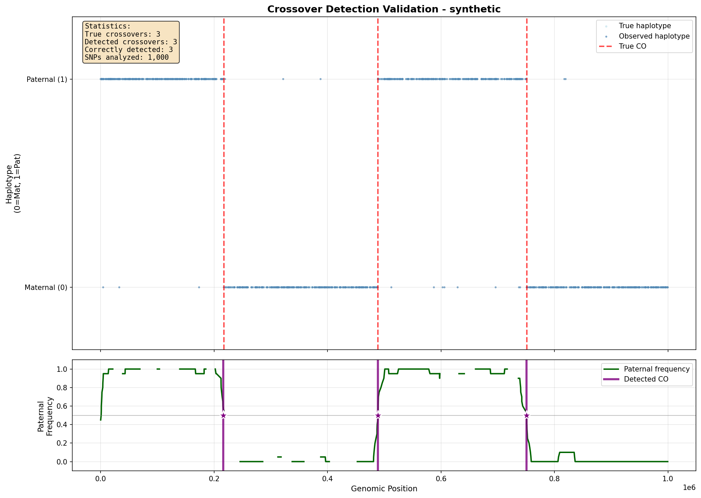

# Lu et al. (2012) Crossover Detection Algorithm

## 论文信息

**标题:** Probing Meiotic Recombination and Aneuploidy of Single Sperm Cells by Whole-Genome Sequencing

**作者:** Sijia Lu, Chenghang Zong, Wei Fan, et al.

**期刊:** Science

**日期:** 2012-12-21

**DOI:** [10.1126/science.1229112](https://www.science.org/doi/10.1126/science.1229112)

---

## 算法概述

该研究对 99 个单个精子细胞进行全基因组测序，开发了**两步法算法**来推断每个精子中 crossover 的基因组位置：

```
┌─────────────────────────────────────────────────────────────────┐
│                    Crossover Detection Pipeline                  │
├─────────────────────────────────────────────────────────────────┤
│                                                                  │
│  Input: SNP genotype data from single sperm cells               │
│                                                                  │
│  Step 1: Rough Estimation                                       │
│  ┌─────────────────────────────────────────────────────────┐    │
│  │ • Calculate SNP ratio in windows of 10 SNPs             │    │
│  │ • Identify transition points between neighboring windows│    │
│  │ • Output: Rough crossover positions                     │    │
│  └─────────────────────────────────────────────────────────┘    │
│                           ↓                                      │
│  Step 2: Accurate Determination (HMM)                           │
│  ┌─────────────────────────────────────────────────────────┐    │
│  │ • 3-state HMM: Paternal (P), Maternal (M), Undetermined │    │
│  │ • Transition probability from rough crossover frequency │    │
│  │ • Emission probability from SNP calling error rate      │    │
│  │ • Viterbi algorithm for most probable haplotype path    │    │
│  └─────────────────────────────────────────────────────────┘    │
│                           ↓                                      │
│  Filtering: Remove conflicting fragments < 300kb                │
│                                                                  │
│  Output: Crossover positions and counts per sperm               │
│                                                                  │
└─────────────────────────────────────────────────────────────────┘
```

---

## 方法详细描述

### Step 1: Rough Estimation（粗略估计）

**原理:**
- 沿基因组以 10 个 SNP 为窗口滑动
- 计算每个窗口中属于父本单倍型 vs 母本单倍型的 SNP 比率
- 识别相邻窗口间比率发生显著转换的位置作为 crossover 候选位点

**公式:**
```
对于窗口 w，计算父本单倍型 SNP 比例：
    
    P_ratio(w) = N_paternal_SNPs(w) / N_total_SNPs(w)

转换点检测：
    如果 |P_ratio(w_i) - P_ratio(w_{i+1})| > threshold
    则位置 i 为 crossover 候选位点
```

### Step 2: Accurate Determination using HMM（HMM 精确定位）

**HMM 模型定义:**

**状态空间 (3 states):**
- **P (Paternal):** 该区域来源于父本单倍型
- **M (Maternal):** 该区域来源于母本单倍型
- **U (Undetermined):** 单倍型未确定（由于测序错误或覆盖度不足）

**转移概率 (Transition Probability):**
```
从粗略估计的 crossover 频率计算：

P(P→M) = P(M→P) = crossover_rate / 2
P(P→P) = P(M→M) = 1 - crossover_rate / 2
P(U→*) = P(*→U) = small_constant (e.g., 0.01)
```

**发射概率 (Emission Probability):**
```
从 SNP calling 错误率计算：

P(观察 paternal SNP | 状态 P) = 1 - error_rate
P(观察 maternal SNP | 状态 P) = error_rate
P(观察 paternal SNP | 状态 M) = error_rate
P(观察 maternal SNP | 状态 M) = 1 - error_rate
P(观察 undetermined | 状态 U) = 1
```

**Viterbi 算法:**
```
寻找最可能的状态序列 S* = argmax_S P(S | Observations)

使用动态规划：
δ_t(i) = max_j [δ_{t-1}(j) × a_ji] × b_i(o_t)

其中:
- δ_t(i): 时刻 t 处于状态 i 的最大概率
- a_ji: 从状态 j 转移到状态 i 的概率
- b_i(o_t): 状态 i 发射观察值 o_t 的概率
```

### Filtering（过滤）

**规则:**
- 过滤掉小于 ~300kb 的冲突基因组片段
- 原因：这些可能是基因转换事件或 DNA 污染，而非真实的 crossover

---

## 输入数据格式

### SNP 基因型数据 (TSV)

```tsv
chromosome	position	ref	alt	snp_id	sperm_genotype	diploid_genotype
chr1	12345	A	G	rs12345	A/G	A/A
chr1	23456	C	T	rs23456	C/T	C/C
chr1	34567	G	A	rs34567	G/A	G/G
...
```

**字段说明:**
- `chromosome`: 染色体编号
- `position`: 基因组位置 (hg19)
- `ref`: 参考等位基因
- `alt`: 替代等位基因
- `snp_id`: SNP 标识符
- `sperm_genotype`: 精子基因型 (单倍型)
- `diploid_genotype`: 二倍体亲本基因型

### 亲本单倍型定相数据 (TSV)

```tsv
chromosome	position	snp_id	haplotype_1	haplotype_2
chr1	12345	rs12345	A	C
chr1	23456	rs23456	T	G
...
```

---

## 输出数据格式

### Crossover 位置 (TSV)

```tsv
sperm_id	chromosome	crossover_start	crossover_end	haplotype_block	confidence
S01	chr1	1500000	2500000	Paternal	0.95
S01	chr1	2500000	8500000	Maternal	0.93
S01	chr1	8500000	12000000	Paternal	0.91
...
```

### Crossover 统计 (TSV)

```tsv
sperm_id	total_crossovers	autosome_crossovers	sex_chromosome_crossovers	mean_resolution_kb
S01	26	25	1	30
S02	24	23	1	28
...
```

---

## 使用示例

### 基本用法

```bash
# 运行完整的 crossover 检测流程
python crossover_detection.py \
    --input data/sperm_snps.tsv \
    --phasing data/phasing_info.tsv \
    --output results/crossovers/

# 指定特定精子样本
python crossover_detection.py \
    --input data/sperm_snps.tsv \
    --sperm-id S01 \
    --output results/crossovers/

# 调整窗口大小
python crossover_detection.py \
    --input data/sperm_snps.tsv \
    --window-size 15 \
    --output results/crossovers/
```

### 可视化验证

```bash
# 生成带有 3 个 crossover 的模拟数据并可视化验证
python visualize_crossover_validation.py \
    --output-dir test_output/

# 自定义参数
python visualize_crossover_validation.py \
    --output-dir test_output/ \
    --n-snps 2000 \
    --error-rate 0.03 \
    --crossover-positions 100 500 900
```

可视化脚本会生成：
- **crossover_validation.png**: 散点图展示单倍型分布和检测到的 crossover 位置（紫色星号标记）
- **validation_summary.txt**: 包含 precision/recall 指标的验证摘要
- **synthetic_snps.tsv**: 模拟的 SNP 基因型数据
- **synthetic_phasing.tsv**: 模拟的单倍型定相数据



### Python API 用法

```python
from crossover_detection import CrossoverDetector

# 初始化检测器
detector = CrossoverDetector(
    window_size=10,
    min_fragment_size=300000,
    error_rate=0.05
)

# 加载数据
detector.load_snp_data("data/sperm_snps.tsv")
detector.load_phasing_data("data/phasing_info.tsv")

# 运行检测
results = detector.detect_crossovers(sperm_id="S01")

# 获取结果
crossover_positions = results.get_crossover_positions()
crossover_count = results.get_crossover_count()
haplotype_blocks = results.get_haplotype_blocks()

# 保存结果
results.save("results/crossovers/")
```

---

## 参数说明

| 参数 | 默认值 | 说明 |
|------|--------|------|
| `--window-size` | 10 | SNP 窗口大小（用于粗略估计） |
| `--min-fragment-size` | 300000 | 最小片段大小（bp），小于此值的片段被过滤 |
| `--error-rate` | 0.05 | SNP calling 错误率（用于 HMM 发射概率） |
| `--crossover-rate` | 0.01 | 先验 crossover 率（用于 HMM 转移概率） |
| `--sperm-id` | None | 指定要分析的精子样本 ID |
| `--chromosome` | None | 指定要分析的染色体（默认全部） |

---

## 依赖项

```
Python >= 3.8
numpy >= 1.20.0
pandas >= 1.3.0
scipy >= 1.7.0
hmmlearn >= 0.2.8
```

安装依赖：
```bash
pip install -r requirements.txt
```

---

## 性能指标

根据 Lu et al. (2012) 原文：

| 指标 | 值 |
|------|-----|
| 精子细胞数量 | 99 |
| 平均基因组覆盖度 | ~0.5-1x |
| 平均常染色体 crossover 数 | 26.0 |
| crossover 定位分辨率 | ~30kb |
| 性别决定 | X/Y 染色体单倍型分析 |

---

## 注意事项

1. **数据质量要求:**
   - 需要准确的亲本单倍型定相信息
   - SNP calling 质量分数应 ≥ Q20
   - 建议最小基因组覆盖度 ≥ 0.3x

2. **过滤冲突片段:**
   - 小于 300kb 的冲突片段可能是基因转换或 DNA 污染
   - 这些片段在后续重组分析中应被排除

3. **性染色体分析:**
   - X/Y 染色体需要单独处理
   - PAR 区域（假常染色体区域）表现出不同的重组模式

4. **计算资源:**
   - 单个精子样本分析时间：~5-10 分钟
   - 内存需求：~2-4 GB（全基因组）

---

## 参考文献

1. Lu S, Zong C, Fan W, et al. Probing Meiotic Recombination and Aneuploidy of Single Sperm Cells by Whole-Genome Sequencing. Science. 2012;338(6114):1627-1630. doi:10.1126/science.1229112

2. Zong C, Lu S, Chapman AR, Xie XS. Genome-wide detection of single-nucleotide and copy-number variations of a single human cell. Science. 2012;338(6114):1622-1626. doi:10.1126/science.1229164

3. Hidden Markov Model. Rabiner LR. A tutorial on hidden Markov models and selected applications in speech recognition. Proceedings of the IEEE. 1989;77(2):257-286.

4. Viterbi Algorithm. Viterbi A. Error bounds for convolutional codes and an asymptotically optimum decoding algorithm. IEEE Transactions on Information Theory. 1967;13(2):260-269.

---

## 许可证

本实现仅用于学术研究和教育目的。

## 联系

如有问题，请提交 GitHub issue 或联系作者。
